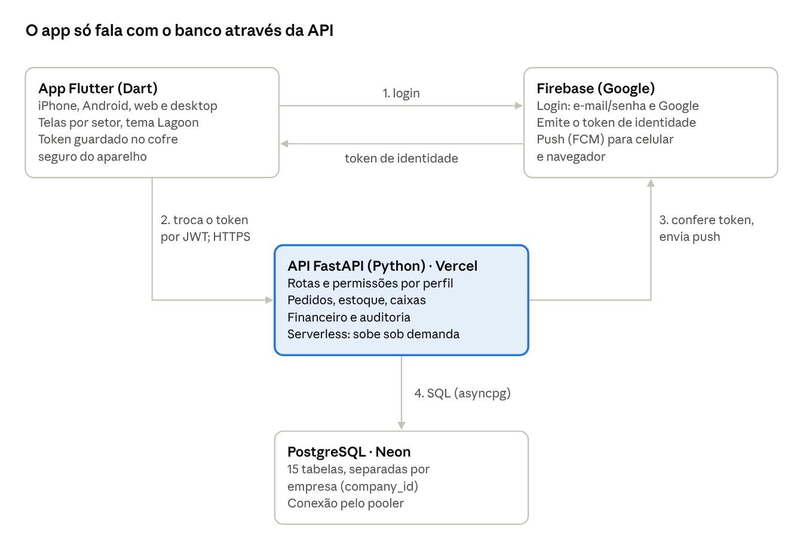
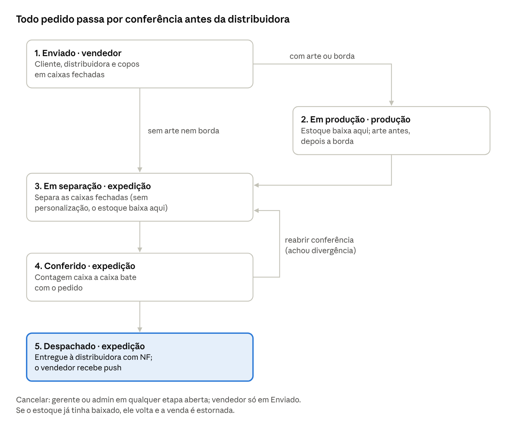

# Dossiê StockIQ — sistema, arquitetura e guia

24/10/2026 · Matheus Vitalino de Moraes

O StockIQ é um ERP para fábricas e distribuidoras de copos: controla estoque, pedidos, produção, expedição e financeiro num app só, em iPhone, Android e navegador. Este dossiê serve de material de ensino, implantação e planejamento para empresas e colaboradores.

> Versão editável e comentável deste documento: <https://claude.ai/artifact/T293EMfW2Ruh5JcoknzVc4> (precisa ser compartilhada pelo dono para outras pessoas abrirem).

## Sumário

1. [Resumo](#1-resumo)
2. [Problema e objetivos](#2-problema-e-objetivos)
3. [Funcionalidades](#3-funcionalidades)
4. [Tecnologias e linguagens](#4-tecnologias-e-linguagens)
5. [Arquitetura](#5-arquitetura)
6. [Banco de dados](#6-banco-de-dados)
7. [Backend (API)](#7-backend-api)
8. [Frontend Flutter](#8-frontend-flutter)
9. [Fluxo de pedidos](#9-fluxo-de-pedidos)
10. [Segurança (cyber)](#10-segurança-cyber)
11. [Infraestrutura e deploy](#11-infraestrutura-e-deploy)
12. [Testes e qualidade](#12-testes-e-qualidade)
13. [Histórico de atualizações](#13-histórico-de-atualizações)
14. [Guia do usuário por perfil](#14-guia-do-usuário-por-perfil)
15. [Implantação do zero](#15-implantação-do-zero)
16. [Planejamento](#16-planejamento)
17. [Equipe, glossário e referências](#17-equipe-glossário-e-referências)

## 1. Resumo

O StockIQ está na versão 1.1.0, em produção na Vercel com banco Neon (PostgreSQL), e cobre o ciclo inteiro do copo: entrada no estoque, venda, personalização (arte e borda), separação, conferência e entrega à distribuidora.

| Item | Situação em 24/10/2026 |
| --- | --- |
| Versão do app | 1.1.0 (build 2) |
| API | FastAPI em produção: backend-livid-one-99.vercel.app |
| Banco | PostgreSQL 16 na Neon (15 tabelas) |
| Plataformas | iPhone, Android, navegador (web) e desktop |
| Perfis de acesso | 6: admin (dono), gerente, vendedor, produção, expedição, operador |
| Testes automatizados | 10 no backend + 13 no app, todos passando |
| Teste de carga | 6.750 requisições, zero erros |

O projeto nasceu como trabalho acadêmico (ISTOKE: controle de estoque por QR Code) e evoluiu para um ERP multiempresa, com cada empresa isolada das demais.

## 2. Problema e objetivos

Fábricas e distribuidoras de copos perdem dinheiro com controle em planilha e papel: estoque que não bate, pedido que some entre vendedor e expedição, caixa enviada errada e ninguém sabendo em que etapa está a carga.

**Problemas que o sistema ataca**

- Estoque desatualizado: baixa manual esquecida ou digitada errada.
- Pedido sem dono: vendedor fecha, mas produção e expedição sabem por WhatsApp.
- Erro de quantidade: cliente pede "10 caixas", alguém separa 10 unidades.
- Conferência fraca: carga sai sem contar caixa por caixa.
- Dono sem visão: não sabe quanto vendeu hoje nem o que está parado.

**Objetivos**

1. Registrar toda entrada e saída com QR Code e usuário responsável.
2. Padronizar a caixa de cada modelo de copo, para vender e conferir em caixas.
3. Levar o pedido por etapas fixas, cada setor vendo só a sua fila.
4. Dar ao dono (admin) o controle de cadastros, equipe e a visão de todas as etapas.
5. Lançar receita e custo automaticamente a cada venda.
6. Funcionar no celular de cada colaborador, com visual simples de iPhone.

## 3. Funcionalidades

O sistema tem 11 módulos; cada perfil vê só os que usa no trabalho (o bloqueio real fica no servidor, não só na tela).

| Módulo | O que faz | Quem usa |
| --- | --- | --- |
| Login | E-mail/senha ou Google via Firebase; sessão renova sozinha | Todos |
| Painel (Início) | Receita, lucro, alertas de estoque, esteira de pedidos | Admin, gerente |
| Produtos | Cadastro com SKU, preço de venda e custo, margem, QR Code | Todos (editar: gerente+) |
| Estoque | Saldo por filial, entrada, saída, transferência, ajuste, alerta de mínimo | Todos |
| QR Code | Leitura pela câmera e PDF de etiquetas para imprimir | Todos |
| Pedidos | Criar, acompanhar e avançar etapas; histórico de quem fez o quê | Vendedor, produção, expedição, gerente+ |
| Conferência | Contagem caixa a caixa antes do despacho | Expedição, gerente+ |
| Clientes | Carteira do vendedor, busca por nome, cidade ou CNPJ | Vendedor, gerente+ |
| Padrões de caixa | Unidades, medidas e peso por modelo de copo, com prévia 3D | Admin edita; todos consultam |
| Distribuidoras | Transportadoras que o vendedor escolhe com o cliente | Admin edita; vendedor escolhe |
| Equipe e IA | Cadastro de pessoas e setores, atividade por funcionário, assistente de IA, relatório PDF | Admin, gerente |

Recursos transversais: notificações push (estoque baixo, pedido novo na fila do setor), tema claro e escuro, aviso de nova atualização ao abrir o app, página 404 própria.

## 4. Tecnologias e linguagens

Duas linguagens principais: **Python** no servidor e **Dart** no app; o banco fala **SQL** (PostgreSQL).

| Camada | Tecnologia | Linguagem | Para que serve |
| --- | --- | --- | --- |
| App (frontend) | Flutter 3.41 | Dart 3.11 | Uma base de código para iPhone, Android, web e desktop |
| Estado do app | Riverpod 2.5 | Dart | Busca e cache de dados com descarte automático |
| Navegação | go_router 13 | Dart | Rotas, redirecionamento por perfil, 404 |
| HTTP no app | Dio 5 | Dart | Chamadas à API, renovação de sessão, retry |
| API (backend) | FastAPI 0.115 | Python 3.12 | Endpoints REST, validação, documentação em /docs |
| Validação | Pydantic 2.7 | Python | Formato e limites de cada requisição |
| Acesso ao banco | SQLAlchemy 2.0 (async) + asyncpg | Python | ORM assíncrono |
| Banco de dados | PostgreSQL 16 (Neon) | SQL | Dados de todas as empresas, isolados por empresa |
| Migrações | Alembic | Python | Evolução do esquema do banco versionada |
| Login | Firebase Authentication | — | E-mail/senha e Google |
| Token interno | JWT HS256 (python-jose) | Python | Sessão da API, 7 dias |
| Push | Firebase Cloud Messaging | — | Notificações no celular e navegador |
| Relatórios | reportlab, qrcode, Pillow | Python | PDF executivo e etiquetas QR |
| IA | Anthropic Claude (opcional) | Python | Assistente que responde com dados reais da empresa |
| Hospedagem | Vercel (serverless) | — | API em produção, escala sozinha |
| Testes | pytest, flutter_test | Python, Dart | Testes automatizados |
| Versionamento | Git + GitHub | — | Histórico e colaboração |

Fontes do visual: sistema do aparelho (SF Pro no iPhone) e Comfortaa no logotipo; paleta Lagoon (#04181C, #0A4A55, #14918F, #4FD8C4, #D4FBF3).

## 5. Arquitetura

O sistema tem quatro peças e uma regra: o app nunca acessa o banco direto, tudo passa pela API, que confere quem é a pessoa e o que ela pode fazer.



O login acontece no Firebase; a API troca o token do Firebase por um JWT próprio e, a partir daí, cada requisição do app leva esse JWT. Push sai da API para o Firebase, que entrega no aparelho.

## 6. Banco de dados

São 15 tabelas no PostgreSQL; quase todas carregam `company_id`, e é esse campo que separa os dados de uma empresa das outras (multiempresa, ou *multi-tenant*).

| Tabela | Guarda | Ligações principais |
| --- | --- | --- |
| companies | Empresa (nome, CNPJ, plano) | Raiz de tudo |
| branches | Filiais (matriz, CD) | companies |
| users | Pessoas, perfil (role), filial | companies, branches |
| products | Modelos de copo: SKU, preços, mínimo, QR | companies |
| stocks | Saldo de cada produto em cada filial (um registro por par) | products, branches |
| movements | Entradas, saídas, transferências, ajustes, com arte/borda | products, branches, users |
| finances | Receita e custo lançados a cada venda (e estornos) | companies, branches |
| logs | Auditoria: quem fez qual ação e quando | users, companies |
| device_tokens | Aparelhos para notificação push | users |
| box_standards | Padrão de caixa: unidades, medidas, peso (um por produto) | products |
| distributors | Distribuidoras/transportadoras | companies |
| customers | Clientes, com o vendedor dono da carteira | companies, users |
| orders | Pedido: número, etapa, cliente, vendedor, distribuidora, NF | customers, users, distributors, branches |
| order_items | Itens do pedido em caixas, com cópia do padrão de caixa | orders, products |
| order_events | Linha do tempo do pedido (de qual etapa para qual, quem) | orders, users |

**Regras de integridade que valem a pena conhecer**

- Número do pedido é sequencial e único por empresa (`#0001`, `#0002`...).
- O item do pedido guarda uma cópia das unidades por caixa e do preço: mudar o padrão depois não altera pedidos antigos.
- Cliente, filial e produto usados em pedido não podem ser apagados (RESTRICT); distribuidora e cliente são desativados, não excluídos.
- Datas são gravadas em UTC; "hoje" no financeiro é calculado no horário de Brasília.
- O esquema evolui por migrações Alembic (0001 inicial, 0002 push, 0003 pedidos); no servidor, tabelas novas também são criadas sozinhas na subida.

## 7. Backend (API)

A API segue quatro camadas, e cada requisição passa por elas nesta ordem: **controller** (rota HTTP e permissão) → **service** (regra de negócio) → **repository** (consulta ao banco) → **model** (tabela).

```
backend/app/
  controllers/   rotas HTTP: auth, users, companies, products, stock,
                 finance, analytics, ai, logistics (pedidos)
  services/      regras: estoque, financeiro, pedidos, push, auth
  repositories/  consultas ao banco (BaseRepository + específicos)
  models/        tabelas (SQLAlchemy)
  schemas/       formato de entrada e saída (Pydantic)
  core/          config, banco, segurança (JWT), Firebase, fuso
  reports/       PDF executivo e etiquetas QR
  ai/            assistente (respostas prontas + Claude)
```

**Endpoints principais** (todos sob `/api/v1`, documentação interativa em `/docs`)

| Grupo | Rotas | Quem pode |
| --- | --- | --- |
| Auth | `POST /auth/login` (troca token Firebase por JWT) | Todos |
| Usuários | `GET/POST/PATCH/DELETE /users` | Gerente lê; admin altera |
| Produtos | `GET/POST/PATCH/DELETE /products`, `/products/{id}/qr`, `/products/qr-labels/pdf`, `/products/scan/{qr}` | Todos leem; gerente cria |
| Estoque | `GET /stock/low`, `/branches/{id}/stock`, `POST /movements`, ajuste | Todos; ajuste só admin |
| Financeiro | `GET /finance/summary`, `/finance` | Gerente+ |
| Padrões de caixa | `GET /box-standards`, `PUT/DELETE /box-standards/{produto}` | Todos leem; admin altera |
| Distribuidoras | `GET/POST/PUT/DELETE /distributors` | Todos leem; admin altera |
| Clientes | `GET/POST/PUT /customers` | Vendedor, gerente+ |
| Pedidos | `GET /orders`, `/orders/summary`, `POST /orders`, `PATCH /orders/{id}` | Conforme setor |
| Etapas | `POST /orders/{id}/transition`, `PUT /orders/{id}/items/{item}/check` | Setor da etapa, gerente+ |
| Saúde | `GET /health`, `GET /health/db` | Público |

**Regras de negócio centrais**

- Saída de estoque valida saldo e lança receita e custo no financeiro; arte soma R$ 2,00 e borda R$ 1,00 por unidade.
- Copo ecológico não aceita borda (o material derrete) — bloqueado no pedido e na saída.
- O pedido baixa o estoque quando sai de "Enviado"; o cancelamento devolve o estoque e estorna o financeiro.
- Estoque que cruza o mínimo dispara push para admin e gerente, uma vez só por queda.
- Toda ação relevante grava um registro de auditoria em `logs`.

## 8. Frontend Flutter

O app é um código Dart só, compilado para iPhone, Android e navegador; ele segue o padrão visual do iOS (Human Interface Guidelines) em todas as plataformas.

```
stockiq-flutter/lib/
  core/        tema Lagoon, rotas, providers (estado), serviços de API,
               sessão, notificações, aviso de atualização
  features/    telas: auth, dashboard, products, stock, qr, orders,
               admin (gestão, caixas, distribuidoras, clientes),
               team, ai_assistant, notifications, errors (404)
  shared/      modelos de dados e componentes visuais reaproveitados
```

**Abas por perfil** (cada pessoa abre direto na fila do seu setor)

| Perfil | Abas na barra inferior | Tela inicial |
| --- | --- | --- |
| Admin / gerente | Início, Pedidos, Produtos, Estoque, Gestão | Painel |
| Vendedor | Pedidos, Clientes, Produtos, Conta | Meus pedidos |
| Produção | Pedidos, Produtos, Estoque, Conta | Fila da produção |
| Expedição | Pedidos, Estoque, QR Code, Conta | Fila da expedição |
| Operador | Produtos, Estoque, QR Code, Conta | Produtos |

**Padrão visual (estilo iPhone)**

- Título grande que encolhe ao rolar, listas agrupadas no estilo Ajustes do iOS, alertas Cupertino.
- Barra de abas flutuante de vidro (desfoque) com indicador em gradiente Lagoon.
- Transição de tela deslizando da direita, rolagem elástica e vibração leve ao tocar.
- Tema claro e escuro (ou automático pelo sistema), escolhido em Gestão/Conta.
- Em tablet e computador, a barra vira menu lateral e o conteúdo fica centralizado.

**Cuidados técnicos do app**

- Sessão: quando o token da API vence, o app pega um novo pelo Firebase sem pedir login.
- Cold start: se o servidor demorar, o app tenta de novo uma vez antes de mostrar erro.
- Memória: dados de produto, QR, busca e pedido ficam em cache de 1 a 5 minutos e são liberados depois.
- Disco: só guarda login, tema, versão vista e até 50 notificações; produto novo não ocupa espaço no aparelho.

## 9. Fluxo de pedidos

O pedido anda em até cinco etapas, e cada uma só pode ser avançada pelo setor dono dela (ou por gerente e admin); pedido sem arte nem borda pula a produção.



A cada passo o servidor grava quem mudou, de qual etapa para qual e quando; o próximo setor recebe push. O vendedor pede em caixas: com o padrão de 25 copos por caixa, 4 caixas viram 100 copos, e a conferência conta essas 4 caixas.

## 10. Segurança (cyber)

A segurança tem cinco camadas, e a regra de ouro é: o app só esconde botões; quem decide o que cada pessoa pode fazer é o servidor.

| Camada | Como funciona | Protege contra |
| --- | --- | --- |
| Autenticação | Firebase verifica senha ou conta Google e emite um token; a API confere esse token com a chave do Firebase | Senha guardada no nosso banco, login falso |
| Sessão | A API devolve um JWT próprio (assinado com SECRET_KEY, 7 dias); a cada requisição checa se a conta segue ativa | Uso de conta desativada, token adulterado |
| Autorização (RBAC) | Cada rota exige um perfil mínimo; cada etapa do pedido só aceita o setor certo | Vendedor despachando carga, operador mexendo em preço |
| Isolamento | Toda consulta filtra pela empresa do usuário; `company_id` nunca vem do app | Uma empresa ver ou alterar dados de outra |
| Segredos | Chaves só em variáveis de ambiente da Vercel; `.env` e credenciais fora do Git e do deploy (`.gitignore`, `.vercelignore`) | Vazamento de chave pelo repositório |

**Outras proteções**

- Validação de toda entrada pelo Pydantic (tipos, tamanhos, quantidades positivas).
- Consultas pelo ORM, sem SQL montado com texto do usuário (evita SQL injection).
- CORS restrito às origens autorizadas; HTTPS obrigatório na Vercel.
- Erros internos voltam como mensagem genérica, sem expor detalhes do servidor; o detalhe vai só para o log.
- Auditoria em `logs`: ação, usuário, empresa, entidade e hora.
- No aparelho, o token fica no armazenamento seguro (Keychain no iPhone, Keystore no Android).

**Pontos de atenção**

- O APK atual é assinado com chave de debug: para a Play Store, é preciso uma chave de release própria.
- Não há limite de requisições por usuário (rate limit) na API; recomendado antes de abrir para muitas empresas.
- Recomendado ativar verificação em duas etapas nas contas de admin do Firebase, Vercel e Neon.

## 11. Infraestrutura e deploy

A API roda na Vercel em modo serverless (sobe instâncias sob demanda), o banco fica na Neon e o login no Firebase; publicar uma versão nova da API é um comando.

| Serviço | Papel | Observação |
| --- | --- | --- |
| Vercel | Hospeda a API (FastAPI) | Projeto `backend`; variáveis em Settings → Environment Variables |
| Neon | PostgreSQL gerenciado | Conexão pelo pooler (PgBouncer); dorme quando ocioso |
| Firebase | Login e notificações push | Chave da conta de serviço na variável FIREBASE_CREDENTIALS_JSON |
| GitHub | Código-fonte | Repositório sistema-istoke, branch `main` |

**Variáveis de ambiente da API**

| Variável | Obrigatória | Para quê |
| --- | --- | --- |
| DATABASE_URL | Sim | Endereço do PostgreSQL (aceita o formato da Neon direto) |
| SECRET_KEY | Sim | Assina os JWT; igual em todas as instâncias |
| FIREBASE_CREDENTIALS_JSON | Sim (produção) | Conta de serviço do Firebase |
| ALLOWED_ORIGINS | Sim (web) | Endereços autorizados a chamar a API pelo navegador |
| DEBUG | Não | `False` em produção |
| ANTHROPIC_API_KEY | Não | Liga o assistente de IA para perguntas livres |

**Como publicar**

1. API: na pasta `backend`, rodar `vercel --prod` (tabelas novas são criadas na subida).
2. App web: `flutter build web` e publicar a pasta `build/web` em hospedagem estática.
3. Android: `flutter build apk --release` (ou `appbundle` para a Play Store).
4. iPhone: `flutter build ipa` num Mac com Xcode e conta Apple Developer.
5. A cada versão: subir `appVersion` e `whatsNew` em `update_service.dart` e o `version` do `pubspec.yaml` — o app mostra "Olá, temos uma nova atualização para você :)".

Melhorias de infraestrutura feitas na 1.1.0: dependências enxutas (cold start de 12 s para 0,7 s), conexão sem pool fixo em serverless, cache de comandos desligado no pooler da Neon, erro 500 legível e `/health/db` para acordar o banco.

## 12. Testes e qualidade

Na versão 1.1.0 passaram 23 testes automatizados (10 backend, 13 app) e um teste de carga em produção com 6.750 requisições, sem nenhum erro 500, timeout ou conexão recusada.

**Testes automatizados**

| Onde | Ferramenta | O que cobre | Resultado |
| --- | --- | --- | --- |
| Backend | pytest + banco SQLite em memória | Produtos (criar, listar, SKU duplicado, busca), saúde da API | 5 de 5 |
| Backend | pytest | Fluxo completo do pedido: padrão de caixa só admin; pedido sem padrão recusado; produção → separação → conferência → despacho; baixa e devolução de estoque; estorno financeiro; vendedor vê só os próprios pedidos | 5 de 5 |
| App | flutter_test | Pedido lido da API, cartão do pedido e caixa 3D sem estouro de tela (claro e escuro) | 3 de 3 |
| App | flutter_test | Tela de detalhe do pedido em 4 etapas, em tela de iPhone de 375 px | 4 de 4 |
| App | flutter_test | Aviso de atualização (uma vez por versão) e layout do aviso | 3 de 3 |
| App | flutter_test | Página 404 em 320 px, 375 px e 1440 px | 3 de 3 |
| App | flutter analyze | Análise estática de todo o código | 0 erros |

**Teste de carga** (produção, 24/10/2026, só rotas sem efeito colateral; logins simulados com token inválido, que passam pela mesma verificação do Firebase)

| Carga | Requisições | Vazão | Tempo típico (p50) | 95% abaixo de (p95) | Erros |
| --- | --- | --- | --- | --- | --- |
| 50 simultâneas | 1.350 | 45 a 213 req/s | 0,2 a 0,6 s | 0,3 a 4,5 s | 0 |
| 150 simultâneas | 4.000 | cerca de 60 req/s | 1,0 a 1,5 s | cerca de 6 s | 0 |
| 300 simultâneas | 1.400 | cerca de 53 req/s | 0,6 a 3,2 s | até 7 s | 0 |

Leitura: até 50 pessoas ao mesmo tempo o sistema responde em menos de meio segundo; acima de 150, as requisições esperam na fila da Vercel, ficam lentas, mas nenhuma falha.

**Como os testes acharam problemas reais**

- Duas telas estouravam a largura do iPhone (data e etiqueta da etapa); corrigido antes de publicar.
- O servidor cortava a lista em 100 produtos; o app agora pede até 500.
- Duas instâncias criando tabelas juntas geravam erro no log; corrigido.

**Como rodar**

```
cd backend && pip install -r requirements-dev.txt && pytest tests -v
cd stockiq-flutter && flutter test && flutter analyze
```

## 13. Histórico de atualizações

Foram 58 commits entre maio e outubro de 2026; abaixo, as entregas que mudaram o sistema, da mais nova para a mais antiga.

| Data | Versão | Entrega |
| --- | --- | --- |
| 24/10/2026 | 1.1.0 | Página 404 em blocos animados |
| 24/10/2026 | 1.1.0 | Aviso "Olá, temos uma nova atualização para você :)"; cache de memória com descarte automático; limite de produtos de 100 para 500 |
| 24/10/2026 | 1.1.0 | Fluxo de pedidos, padrão de caixa, distribuidoras, clientes, setores; visual iOS com paleta Lagoon; sessão que não cai; API estável na Vercel |
| 03/09/2026 | 1.0.0 | Barra inferior com indicador deslizante; tela responsiva para tablet e desktop; notificações salvas |
| 02/09/2026 | 1.0.0 | Push real (FCM); preparação do backend para a Vercel; login Google nativo no celular |
| 01/09/2026 | 1.0.0 | Módulo financeiro; personalização de copos (arte e borda); gestão de equipe; Android e iOS; etiquetas QR em PDF; login com Google; assistente de IA |
| 15/06/2026 | antes da 1.0 | Backend FastAPI no repositório; reorganização do projeto |
| 27/05/2026 | antes da 1.0 | POPs, ambiente de desenvolvimento, sprint 01, evidências |
| 04/05/2026 | antes da 1.0 | Backlog e visão do projeto ISTOKE |

## 14. Guia do usuário por perfil

Cada colaborador usa o mesmo app; o que muda é o perfil que o admin dá a ele em Gestão → Equipe e setores.

### Admin (dono do estabelecimento)

1. Entre com sua conta (o primeiro login com Google cria a empresa e você vira admin).
2. Em **Gestão → Equipe e setores → Pessoas**, cadastre cada colaborador pelo e-mail e escolha o setor (vendedor, produção, expedição, gerente, operador). No primeiro login dele, a conta é vinculada sozinha.
3. Em **Produtos**, cadastre os modelos de copo com SKU, preço de venda, custo e estoque mínimo.
4. Em **Gestão → Padrões de caixa**, defina para cada modelo: unidades por caixa, medidas e peso. Modelo sem padrão não pode ser pedido.
5. Em **Gestão → Distribuidoras**, cadastre as transportadoras e as regiões que atendem.
6. Acompanhe no **Início**: receita e lucro do dia, alertas de estoque e a esteira de pedidos. Baixe o relatório executivo em PDF pelo ícone no topo.
7. Você pode avançar ou cancelar qualquer pedido em qualquer etapa.

### Gerente

Mesmo acesso operacional do admin (pedidos, estoque, produtos, painel, IA). Não altera padrões de caixa, distribuidoras nem a equipe.

### Vendedor

1. Na aba **Clientes**, cadastre o cliente (nome, CNPJ/CPF, cidade, endereço).
2. Na aba **Pedidos**, toque em **Novo pedido**.
3. Escolha o cliente e, combinado com ele, a distribuidora que vai levar a carga.
4. Adicione os modelos de copo e a quantidade **em caixas** (o app mostra quantas unidades dá).
5. Marque **Arte** e/ou **Borda** se o copo for personalizado e descreva a arte (copo ecológico não aceita borda).
6. Toque em **Enviar à fábrica**. O pedido segue para a produção (se personalizado) ou direto para a expedição.
7. Acompanhe a etapa em **Meus pedidos**; você recebe push quando a carga é despachada. Só dá para cancelar enquanto o pedido estiver em "Enviado".

### Produção

1. A aba **Pedidos** abre na **Fila da produção** (pedidos com arte ou borda).
2. Abra o pedido e toque em **Iniciar produção**: o estoque dos copos é baixado nesse momento.
3. Aplique a arte (sempre antes) e a borda conforme a descrição de cada item.
4. Toque em **Enviar pra separação**. A expedição recebe um push.

### Expedição (separação e conferência)

1. A aba **Pedidos** abre na fila da expedição. Pedido sem personalização chega direto: toque em **Enviar pra separação** para começar.
2. Separe as caixas fechadas de cada modelo.
3. Na **Conferência de caixas**, conte e ajuste o número de cada item com + e −. O botão só libera quando todas as caixas batem.
4. Toque em **Concluir conferência** (anote divergências, se houver). Achou erro depois? Use ⋯ → **Reabrir conferência**.
5. Na entrega à distribuidora, toque em **Despachar**, informe a NF e o rastreio. Volumes e peso aparecem calculados no pedido.

### Operador

Consulta produtos, registra entradas e saídas de estoque e lê QR Codes das etiquetas com a câmera.

### Para todos

- Tema claro, escuro ou automático: em **Gestão** ou **Conta → Aparência**.
- Puxe a lista para baixo para atualizar.
- Quando houver versão nova, o app avisa ao abrir; na web, toque em **Atualizar agora**.
- A sessão não cai sozinha; para sair, use **Sair da conta**.

## 15. Implantação do zero

Uma empresa nova fica operando em cerca de um dia de trabalho do dono, em sete passos; a parte técnica (servidor) só é necessária se a empresa quiser uma instalação própria.

**A. Empresa usando o StockIQ já publicado**

1. Instale o app (APK no Android; no iPhone, pelo TestFlight ou pela versão web no Safari).
2. O dono entra com a conta Google da empresa: o sistema cria a empresa, a filial "Matriz" e o torna admin.
3. Cadastre os produtos (pode começar pelos 10 modelos que mais vendem).
4. Imprima as etiquetas QR em PDF (Produtos → ícone de etiquetas) e cole nas prateleiras ou caixas.
5. Lance o estoque inicial de cada produto (Estoque → Entrada, ou ajuste direto).
6. Defina os padrões de caixa e cadastre as distribuidoras.
7. Cadastre a equipe com o setor de cada um e faça um pedido de teste passando por todas as etapas.

**B. Instalação própria (equipe técnica)**

1. Pré-requisitos: Git, Python 3.12, Flutter 3.41, Node.js (CLI da Vercel), contas Firebase, Neon e Vercel.
2. Clonar: `git clone https://github.com/jaozsf/sistema-istoke.git`.
3. Firebase: criar projeto, ativar login por e-mail e Google, gerar a chave da conta de serviço.
4. Neon: criar o banco e copiar a URL do pooler.
5. Local: em `backend`, `pip install -r requirements-dev.txt`, copiar `.env.example` para `.env`, preencher e rodar `uvicorn app.main:app --reload` (ou `docker compose up -d`).
6. Produção: `vercel --prod` em `backend` e cadastrar as variáveis da seção 11.
7. App: `flutterfire configure` com o seu Firebase, ajustar `baseUrl` em `app_constants.dart`, `flutter pub get` e `flutter run`.
8. Validar: `/health/db` responde `ok`, testes passam, login funciona e um pedido de teste chega ao despacho.

## 16. Planejamento

As próximas entregas priorizam o que trava a adoção por mais empresas: publicação nas lojas, paginação e limites de uso. Não há datas definidas; a ordem abaixo é a sugerida.

**Roadmap sugerido**

1. Publicar o app web e gerar o APK com chave de release própria; enviar iPhone ao TestFlight.
2. Paginação de produtos e pedidos (catálogo acima de 500 itens).
3. Limite de requisições por usuário na API e verificação em duas etapas para admins.
4. Leitura de QR Code na conferência (conta a caixa ao escanear a etiqueta).
5. Tela de previsão de demanda (o endpoint `/analytics/forecast` já existe).
6. Etiqueta de volume para a carga (número do pedido, cliente, caixa 1 de N).
7. Relatório por vendedor e por distribuidora (prazo, volume, cancelamentos).

**Riscos e respostas**

| Risco | Impacto | Resposta |
| --- | --- | --- |
| Muitos usuários ao mesmo tempo | Lentidão acima de 150 simultâneos | Plano pago da Vercel ou servidor dedicado; cache de leituras |
| Banco Neon dormindo | Primeira requisição mais lenta | App já "acorda" o banco no boot; plano sem suspensão se necessário |
| Chave secreta vazada | Acesso indevido | Trocar SECRET_KEY na Vercel (todos fazem login de novo) e girar a chave do Firebase |
| Colaborador sem treino | Pedido parado ou etapa errada | Plano de treinamento abaixo; o app só mostra o botão certo para cada setor |
| Dependência de internet | Sem conexão, sem registro | Modo offline é candidato a roadmap; até lá, Wi-Fi no galpão |

**Plano de treinamento dos colaboradores**

| Turma | Duração | Conteúdo | Prática |
| --- | --- | --- | --- |
| Dono e gerentes | 2 h | Cadastros, equipe, padrões de caixa, distribuidoras, painel, relatório | Montar a empresa do zero em ambiente de teste |
| Vendedores | 1 h | Clientes, novo pedido em caixas, arte e borda, distribuidora | 3 pedidos de teste, um com personalização |
| Produção | 30 min | Fila, iniciar produção, ordem arte → borda, enviar para separação | Levar 2 pedidos até a separação |
| Expedição | 1 h | Separação, conferência caixa a caixa, divergências, despacho com NF | Conferir e despachar 2 pedidos |
| Operadores | 30 min | Entrada e saída de estoque, leitura de QR | Registrar 5 movimentações |

Sugestão: uma semana de operação em paralelo com o controle antigo antes de desligar a planilha.

## 17. Equipe, glossário e referências

**Equipe do projeto** (conforme docs/workflow/team-organization.md)

| Integrante | Papel |
| --- | --- |
| Matheus Vitalino de Moraes | Liderança, organização e acompanhamento |
| João Vitor Bazarin Neto | Front-end mobile (Flutter) |
| Otávio Berse | Backend e lógica do sistema |
| Giovani Andrade | Modelagem do banco de dados e testes |

**Glossário**

| Termo | Significado |
| --- | --- |
| API | Servidor que o app chama para ler e gravar dados |
| Backend / frontend | Parte do servidor / parte que a pessoa vê (o app) |
| Cold start | Primeira resposta lenta quando o servidor estava parado |
| CORS | Regra do navegador sobre quais sites podem chamar a API |
| Deploy | Publicar uma versão nova |
| JWT | Crachá digital assinado que prova quem está logado |
| Multi-tenant | Várias empresas no mesmo sistema, cada uma vendo só o seu |
| Padrão de caixa | Quantas unidades de um modelo vão numa caixa fechada |
| Pooler | Intermediário que reaproveita conexões com o banco |
| RBAC | Permissão por perfil (role) |
| Serverless | Servidor que sobe e desce sozinho conforme o uso |
| SKU | Código único do produto |

**Referências**

- [Documentação do FastAPI](https://fastapi.tiangolo.com/)
- [Documentação do Flutter](https://docs.flutter.dev/)
- [Human Interface Guidelines (Apple)](https://developer.apple.com/design/human-interface-guidelines/)
- [SQLAlchemy 2.0](https://docs.sqlalchemy.org/en/20/)
- [Neon: conexões com pooler](https://neon.tech/docs/connect/connection-pooling)
- [Vercel: funções Python](https://vercel.com/docs/functions/runtimes/python)
- [Firebase Authentication](https://firebase.google.com/docs/auth)
- [Comfortaa (Google Fonts)](https://fonts.google.com/specimen/Comfortaa)
- Repositório: [github.com/jaozsf/sistema-istoke](https://github.com/jaozsf/sistema-istoke)
